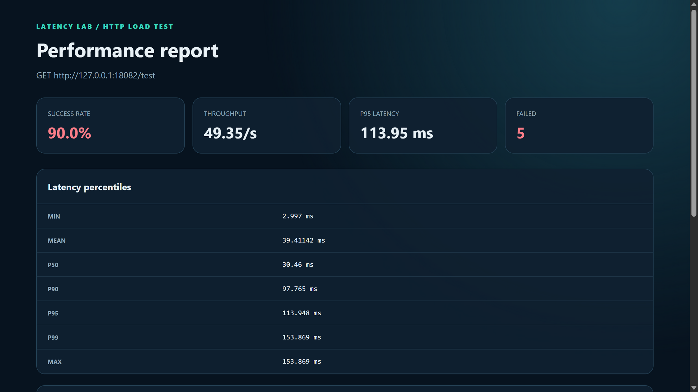

# latency-lab

一个不依赖第三方运行时库的 Java 17 并发 HTTP 压测工具。支持并发控制、RPS 限速、请求超时、延迟百分位统计，以及 JSON、CSV 和 HTML 报告。可用于验证自己的 Spring Boot 服务，也可作为学习 Java 并发与性能分析的小型工程。

> 只对自己拥有或明确获准测试的服务运行压测。示例中的 503 是本地演示服务器故意生成的错误，用于验证失败统计。

## 功能

- 固定线程池控制并发，调度器按目标 RPS 平滑提交任务。
- Java `HttpClient` 连接及请求超时，记录每个请求的状态、响应大小和耗时。
- 统计吞吐量、成功率、状态码、错误类型及 `min / mean / P50 / P90 / P95 / P99 / max`。
- 使用纳秒计时并在结果层统一转换为微秒，避免单位混淆。
- 生成控制台摘要、汇总 JSON、逐请求 CSV 和无外部依赖的 HTML 报告。
- 任何非 2xx 或请求异常都会返回非零退出码，便于接入性能检查。

## 构建

要求 JDK 17 和 Maven 3.9+：

```bash
mvn clean verify
```

可执行 JAR 位于 `target/latency-lab-1.0.0.jar`。

## 快速体验

先启动本地演示服务：

```bash
python scripts/demo_server.py
```

另开终端执行 50 个请求，限制并发为 5、目标速率为 50 RPS：

```bash
java -jar target/latency-lab-1.0.0.jar \
  --url http://127.0.0.1:18082/test \
  --requests 50 \
  --concurrency 5 \
  --rate 50 \
  --timeout 2s \
  --json reports/summary.json \
  --csv reports/requests.csv \
  --html docs/sample-report.html
```

演示服务器每第 10 个请求故意返回一次 503，因此示例退出码为 `1`，这证明失败检测生效。报告会显示成功率、吞吐量、P95/P99 和 200/503 状态分布。

## 参数

| 参数 | 默认值 | 说明 |
|---|---|---|
| `--url` | 必填 | 目标 HTTP(S) 地址 |
| `--method` | `GET` | HTTP 方法 |
| `--body` | 空 | 随请求发送的文本 |
| `--requests`, `-n` | `100` | 总请求数 |
| `--concurrency`, `-c` | `10` | 最大工作线程数 |
| `--rate` | `0` | 每秒请求数，`0` 表示不限速 |
| `--timeout` | `2s` | 超时时间，支持 `ms / s / m` |
| `--json` | 不生成 | 汇总 JSON 路径 |
| `--csv` | 不生成 | 逐请求 CSV 路径 |
| `--html` | 不生成 | HTML 报告路径 |

## 退出码

- `0`：全部请求为 2xx。
- `1`：至少一个请求失败或返回非 2xx。
- `2`：参数、URL 或执行配置错误。

## 测试

```bash
mvn clean verify
```

测试覆盖最近秩百分位算法、RPS 调度、真实 HTTP 并发调用、延迟单位上限、JSON/CSV/HTML 输出和错误参数。GitHub Actions 使用 JDK 17 执行同一套验证。

## 简历表述

> 使用 Java 17 线程池、任务调度和 HttpClient 独立实现 HTTP 压测 CLI，支持并发与 RPS 控制、超时及 P50/P95/P99 延迟分析，输出 JSON、CSV 和 HTML 报告，并通过真实本地服务测试限速与失败统计。
